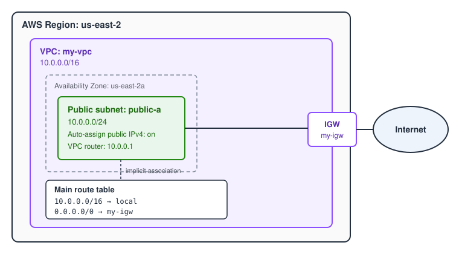
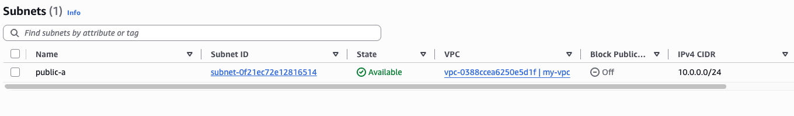
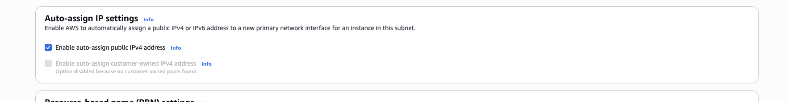
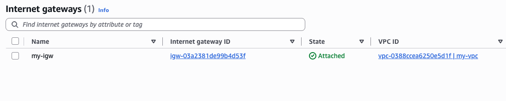
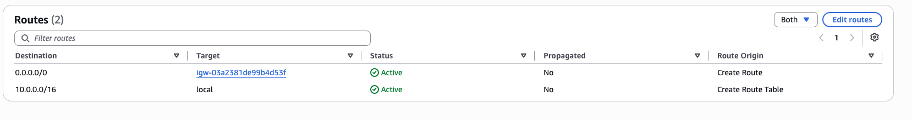

# Lab 01: Build a VPC

**Source:** NextWork · **Date:** 2026-10-22 · **Time spent:** ~20 min · **Cost:** $0.00

## Goal

Build a custom VPC with one public subnet that can reach the internet. This is the foundation that every later lab in this repo builds on.

## Architecture



## What I built

- **VPC** `my-vpc`, 10.0.0.0/16, in us-east-2
- **Public subnet** `public-a`, 10.0.0.0/24 in us-east-2a, with auto-assign public IPv4 turned on
- **Internet gateway** `my-igw`, attached to the VPC
- **Main route table** with a default route `0.0.0.0/0 → my-igw` next to the built-in `10.0.0.0/16 → local` route

## How to deploy

Built with the AWS CLI in CloudShell. The subnet setting and the route were done in the console.

```bash
REGION=us-east-2
AZ=${REGION}a

# VPC
VPC_ID=$(aws ec2 create-vpc --cidr-block 10.0.0.0/16 --region $REGION \
  --tag-specifications 'ResourceType=vpc,Tags=[{Key=Name,Value=my-vpc}]' \
  --query 'Vpc.VpcId' --output text)

# Public subnet
SUBNET_ID=$(aws ec2 create-subnet --vpc-id $VPC_ID --cidr-block 10.0.0.0/24 \
  --availability-zone $AZ --region $REGION \
  --tag-specifications 'ResourceType=subnet,Tags=[{Key=Name,Value=public-a}]' \
  --query 'Subnet.SubnetId' --output text)

# Internet gateway
IGW_ID=$(aws ec2 create-internet-gateway --region $REGION \
  --tag-specifications 'ResourceType=internet-gateway,Tags=[{Key=Name,Value=my-igw}]' \
  --query 'InternetGateway.InternetGatewayId' --output text)
aws ec2 attach-internet-gateway --vpc-id $VPC_ID --internet-gateway-id $IGW_ID --region $REGION
```

Then, in the console:

- **VPC → Subnets → public-a → Edit subnet settings:** turn on auto-assign public IPv4.
- **VPC → Route tables → main table for my-vpc → Edit routes:** add `0.0.0.0/0` with the internet gateway as its target.

A Terraform version is planned.

## How I verified it

The VPC is available with the right CIDR:

```
$ aws ec2 describe-vpcs --vpc-ids $VPC_ID --region $REGION \
    --query 'Vpcs[0].[VpcId,CidrBlock,State]' --output table
|  vpc-0388ccea6250e5d1f  |
|  10.0.0.0/16            |
|  available              |
```

| Check | Screenshot |
|---|---|
| Subnet `public-a` is available in my-vpc with 10.0.0.0/24 |  |
| Auto-assign public IPv4 is on |  |
| The internet gateway is attached to my-vpc |  |
| The route table has both routes, and both are active |  |

## What broke and how I fixed it

Nothing failed outright. The interesting part was where my traditional networking habits didn't carry over to AWS.

**"A public IP means it routes out its default gateway."** On a traditional network, a host with a public IP and a default gateway can reach the internet. In AWS, the instance's default gateway is the VPC router (the subnet's .1 address, 10.0.0.1 here), not the internet gateway. The VPC router forwards packets based on the subnet's route table. With only the `local` route, traffic to 8.8.8.8 matches nothing and gets dropped. The public IP isn't even configured on the instance. The instance only knows its private address, and the IGW maps between the two. **Fix:** add `0.0.0.0/0 → igw`. That route, not the public IP setting, is what makes a subnet "public."

**"We need a source-based or return route."** VPC route tables route by destination only. Replies coming back in through the IGW reach the instance through the `local` route, so no return route is needed. The only missing piece was the outbound default route.

**"The first route listed wins."** Route order doesn't matter, because the console just sorts the list. AWS uses longest prefix match, so for 10.0.0.25 the `/16 local` route wins over `/0`. That's the same rule a traditional router uses.

## Cost and teardown

Everything in this lab is free: VPCs, subnets, internet gateways and route tables have no hourly charge. Nothing was launched that uses a public IPv4 address. The VPC is being kept for Lab 02. To remove it, delete in this order: detach and delete the IGW, delete the subnet, then delete the VPC.

## What I'd do in production

- **Separate public route table.** I added the internet route to the main route table because this lab has one subnet. In production, keep the main table private and create a dedicated public route table. Then any new subnet defaults to having no internet route, instead of accidentally becoming public.
- **Multiple AZs.** Use at least two public subnets in different AZs, so a single AZ failure doesn't take everything down.
- **Plan the CIDR.** Pick address space that won't overlap with other VPCs or on-prem ranges, so peering and VPN (Labs 06 and 12) stay possible.
- **Infrastructure as code** instead of console clicks, with consistent naming and tagging.
- **VPC Flow Logs** for visibility (Lab 07).
