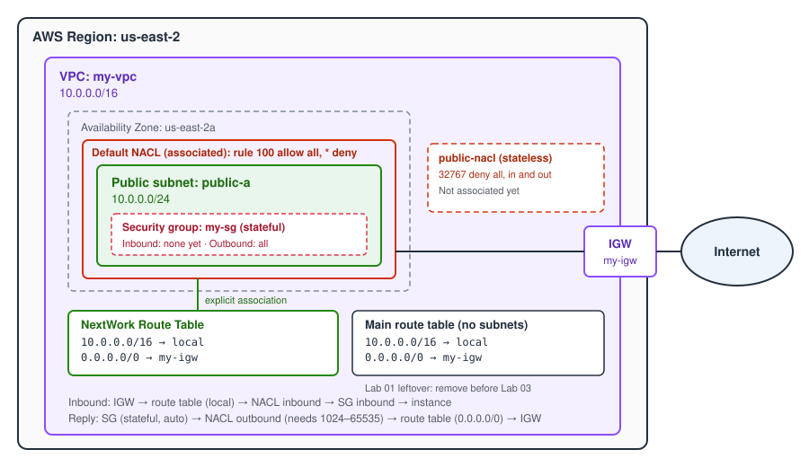
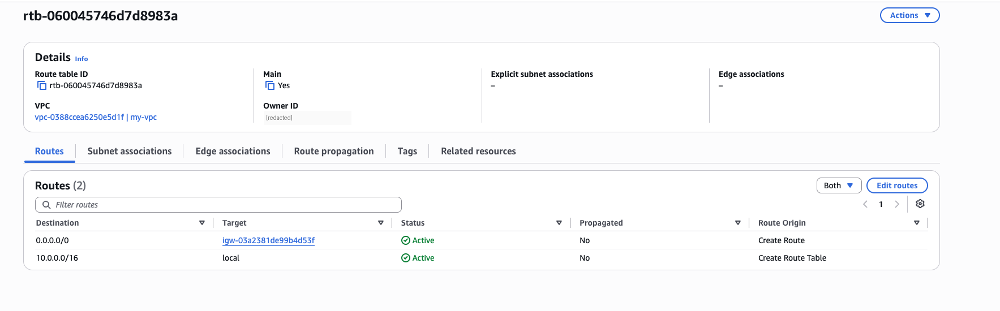
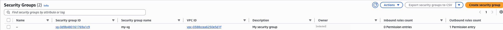
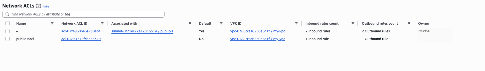

# Lab 02: VPC Traffic Flow and Security

**Source:** NextWork · **Date:** 2026-10-26 · **Time spent:** ~1h · **Cost:** $0.00

## Goal

Add the three traffic controls a VPC gives you to the Lab 01 network: a dedicated route table, a security group and a network ACL. Then trace how a web request moves through each of them on the way in and on the way back out.

## Architecture



## What I built

Reused from [Lab 01](../01-build-a-vpc/README.md): `my-vpc` (10.0.0.0/16), `public-a` (10.0.0.0/24, us-east-2a) and `my-igw`.

- **Public route table** `NextWork Route Table` with `10.0.0.0/16 → local` and `0.0.0.0/0 → my-igw`, **explicitly associated** with public-a. public-a no longer relies on the main route table.
- **Security group** `my-sg` in my-vpc. It comes with the AWS default rules: no inbound, all outbound.
- **Network ACL** `public-nacl` in my-vpc, tagged at creation. It starts with only the built-in deny-all rule (32767) in each direction.

## How to deploy

Built with the AWS CLI in CloudShell (us-east-2). The Lab 01 IDs were looked up with `describe-*` calls into shell variables first, since CloudShell doesn't keep variables between sessions.

```bash
# Public route table: create, default route to the IGW, associate with public-a
RTB_ID=$(aws ec2 create-route-table --vpc-id $VPC_ID \
  --query 'RouteTable.RouteTableId' --output text)
aws ec2 create-route --route-table-id $RTB_ID --destination-cidr-block 0.0.0.0/0 --gateway-id $IGW_ID
aws ec2 associate-route-table --route-table-id $RTB_ID --subnet-id $SUBNET_ID

# Network ACL, tagged at creation
NACL_ID=$(aws ec2 create-network-acl --vpc-id $VPC_ID \
  --tag-specifications 'ResourceType=network-acl,Tags=[{Key=Name,Value=public-nacl}]' \
  --query 'NetworkAcl.NetworkAclId' --output text)
```

The security group `my-sg` was created in my-vpc in the same session, and the route table was tagged `NextWork Route Table` afterwards.

## How a request flows through the VPC

How a browser request reaches a web server in public-a and how the reply gets back:

1. **Internet → IGW.** The request arrives at `my-igw`, which maps the instance's public IP to its private IP.
2. **Route table.** Inside the VPC, the destination is in 10.0.0.0/16, so the `local` route delivers it to public-a.
3. **Network ACL (inbound).** The subnet's NACL checks its inbound rules lowest number first. The first match decides allow or deny.
4. **Security group (inbound).** The instance's security group must have a rule allowing port 80 (or 443) from the client.
5. **Instance.** The web server answers.
6. **Security group (outbound).** Security groups are **stateful**: the reply to an allowed inbound connection goes out automatically, with no outbound rule needed.
7. **Network ACL (outbound).** NACLs are **stateless**: the reply is judged as new traffic. It goes to the client's *ephemeral* port, so the NACL needs an outbound allow for **TCP 1024–65535**.
8. **Route table → IGW → internet.** The reply matches `0.0.0.0/0 → my-igw` and leaves the VPC.

## How I verified it

The new route table has the IGW route and an explicit association with public-a (`Main: false`, SubnetId set):

```
$ aws ec2 describe-route-tables --filters Name=route-table-id,Values=$RTB_ID
  RouteTableId  rtb-08c110fde734a15b5   Tags: Name=NextWork Route Table
  Associations  Main: false   SubnetId: subnet-0f21ec72e12816514 (public-a)
  Routes        10.0.0.0/16 → local         active
                0.0.0.0/0   → igw-03a2381de99b4d53f   active
```

The new NACL starts as deny-all and isn't attached to anything yet:

```
$ aws ec2 describe-network-acls --filters Name=network-acl-id,Values=$NACL_ID
  NetworkAclId  acl-038b1a72fc6555319   Tags: Name=public-nacl   IsDefault: false
  Associations  []
  Entries       32767  ingress  all  0.0.0.0/0  deny
                32767  egress   all  0.0.0.0/0  deny
```

| Check | Screenshot |
|---|---|
| The main route table no longer has public-a as an explicit association (it still has the IGW route, see below) |  |
| `my-sg` is in my-vpc with 0 inbound and 1 outbound (allow-all) rule |  |
| public-a is on the default NACL (2 rules each way); `public-nacl` is unattached with 1 rule each way |  |

## What broke and how I fixed it

**Filter syntax.** My first filter, `--filters Name=RouteTableId,$RTB_ID`, failed for two reasons. Filter names aren't the JSON field names (it's `route-table-id`, not `RouteTableId`), and the value needs its own key (`Values=`). For a single known ID, `--route-table-ids` is simpler. Filters are worth it for questions like "every route table in this VPC".

**The output pager.** Long `describe-*` output opened in a pager, printed twice and ended in `(END)`. The CLI pipes output through `less` by default, and you can turn that off.

**Default vs custom NACL.** The default NACL has a rule 100 that allows all traffic, before the `*` deny. That's why NACLs are invisible until you create a custom one: a new NACL has only the deny, so associating it before adding rules cuts the subnet off in both directions.

**"Associate" a NACL.** There's no `associate-network-acl`. Every subnet always has exactly one NACL, so you *replace* the existing association, and that call takes the association ID, not the subnet ID.

## Cost and teardown

Everything here is free: route tables, security groups and NACLs have no charge, and no instances were launched. The resources stay in place for the next labs.

Not done yet, by design: `my-sg` has no inbound rule, and `public-nacl` has no allow rules and isn't associated with public-a, so public-a still uses the default NACL. The lab only creates these resources. Rules get added when later labs launch an instance behind them.

Known leftover: the **main** route table still has `0.0.0.0/0 → my-igw` from Lab 01. It's kept because the lab uses it next. It must be removed before Lab 03, or the private subnet would silently inherit an internet route.

## What I'd do in production

- **Keep the main route table private.** Public routes only on explicitly associated tables, so new subnets default to having no internet route.
- **Security groups as the main control.** Least-privilege inbound (HTTPS only, from a load balancer's security group rather than 0.0.0.0/0) and restricted outbound instead of allow-all.
- **NACLs as a coarse guardrail.** Subnet-wide allows and denies with gaps in rule numbers (100, 110, 120), and ephemeral ports 1024–65535 allowed for return traffic.
- **HTTPS, not HTTP.** Terminate TLS at a load balancer (Lab 14) and don't expose port 80 except to redirect.
- **Tag everything at creation** with consistent names, so the console and cost reports are readable.
